<!-- Manveer Anand · GitHub profile README
     Palette: navy #080c18 base with indigo #779dff, teal #5eead4, green #8ed345,
     amber #fcca1b, coral #ff7a90, violet #c084fc. Anything added later should use these. -->



---

<h2></h2>

<a href="https://github.com/ManveerAnand/VoiceLink" title="Open VoiceLink. The ring shows its language mix."></a>
<a href="https://github.com/ManveerAnand/BOLBOT" title="Open BOLBOT. The ring shows its language mix."></a>
<a href="https://github.com/ManveerAnand/india-river-atlas" title="Open India River Atlas. The ring shows its language mix."></a>
<a href="https://github.com/ManveerAnand/articulate3D" title="Open articulate3D. The ring shows its language mix."></a>

---

  

 

+Manveer+Anand+%7C+BTech+CSE+4th+Year+%7C+Builder" />

+Full-stack+AI+engineer%3A+models+inside+real+apps" />

+connected.+access+code%3A+40549fMA" />

+press+%5BM%5D+to+enter+the+world" />

<b>Game 1 · Missile Game</b>

Press <kbd>M</kbd> in the game, set <b>Team</b> to <code>40549fMA</code>, type your name, hit Save. Then fly, and try to beat my score on the team <b>Scoreboard</b>.

<b>Game 2 · Chess</b> (you're white, I'm black)

<!-- CHESS:START -->

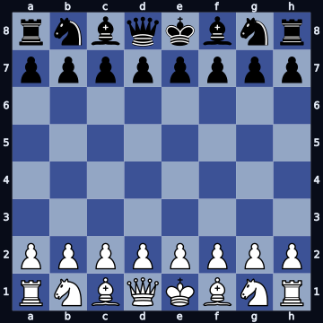

<b>Your move (white).</b> Pick one, swap in the access code, submit.

<a href="https://github.com/ManveerAnand/ManveerAnand/issues/new?title=chess%7CENTER-CODE%7Cb1a3&body=Replace+ENTER-CODE+in+the+title+with+the+access+code+from+my+terminal%2C+then+press+Submit.+Your+move+is+played+within+a+minute+or+so.">Na3</a> <a href="https://github.com/ManveerAnand/ManveerAnand/issues/new?title=chess%7CENTER-CODE%7Cb1c3&body=Replace+ENTER-CODE+in+the+title+with+the+access+code+from+my+terminal%2C+then+press+Submit.+Your+move+is+played+within+a+minute+or+so.">Nc3</a> <a href="https://github.com/ManveerAnand/ManveerAnand/issues/new?title=chess%7CENTER-CODE%7Cg1f3&body=Replace+ENTER-CODE+in+the+title+with+the+access+code+from+my+terminal%2C+then+press+Submit.+Your+move+is+played+within+a+minute+or+so.">Nf3</a> <a href="https://github.com/ManveerAnand/ManveerAnand/issues/new?title=chess%7CENTER-CODE%7Cg1h3&body=Replace+ENTER-CODE+in+the+title+with+the+access+code+from+my+terminal%2C+then+press+Submit.+Your+move+is+played+within+a+minute+or+so.">Nh3</a> <a href="https://github.com/ManveerAnand/ManveerAnand/issues/new?title=chess%7CENTER-CODE%7Ca2a3&body=Replace+ENTER-CODE+in+the+title+with+the+access+code+from+my+terminal%2C+then+press+Submit.+Your+move+is+played+within+a+minute+or+so.">a3</a> <a href="https://github.com/ManveerAnand/ManveerAnand/issues/new?title=chess%7CENTER-CODE%7Ca2a4&body=Replace+ENTER-CODE+in+the+title+with+the+access+code+from+my+terminal%2C+then+press+Submit.+Your+move+is+played+within+a+minute+or+so.">a4</a> <a href="https://github.com/ManveerAnand/ManveerAnand/issues/new?title=chess%7CENTER-CODE%7Cb2b3&body=Replace+ENTER-CODE+in+the+title+with+the+access+code+from+my+terminal%2C+then+press+Submit.+Your+move+is+played+within+a+minute+or+so.">b3</a> <a href="https://github.com/ManveerAnand/ManveerAnand/issues/new?title=chess%7CENTER-CODE%7Cb2b4&body=Replace+ENTER-CODE+in+the+title+with+the+access+code+from+my+terminal%2C+then+press+Submit.+Your+move+is+played+within+a+minute+or+so.">b4</a> <a href="https://github.com/ManveerAnand/ManveerAnand/issues/new?title=chess%7CENTER-CODE%7Cc2c3&body=Replace+ENTER-CODE+in+the+title+with+the+access+code+from+my+terminal%2C+then+press+Submit.+Your+move+is+played+within+a+minute+or+so.">c3</a> <a href="https://github.com/ManveerAnand/ManveerAnand/issues/new?title=chess%7CENTER-CODE%7Cc2c4&body=Replace+ENTER-CODE+in+the+title+with+the+access+code+from+my+terminal%2C+then+press+Submit.+Your+move+is+played+within+a+minute+or+so.">c4</a> <a href="https://github.com/ManveerAnand/ManveerAnand/issues/new?title=chess%7CENTER-CODE%7Cd2d3&body=Replace+ENTER-CODE+in+the+title+with+the+access+code+from+my+terminal%2C+then+press+Submit.+Your+move+is+played+within+a+minute+or+so.">d3</a> <a href="https://github.com/ManveerAnand/ManveerAnand/issues/new?title=chess%7CENTER-CODE%7Cd2d4&body=Replace+ENTER-CODE+in+the+title+with+the+access+code+from+my+terminal%2C+then+press+Submit.+Your+move+is+played+within+a+minute+or+so.">d4</a> <a href="https://github.com/ManveerAnand/ManveerAnand/issues/new?title=chess%7CENTER-CODE%7Ce2e3&body=Replace+ENTER-CODE+in+the+title+with+the+access+code+from+my+terminal%2C+then+press+Submit.+Your+move+is+played+within+a+minute+or+so.">e3</a> <a href="https://github.com/ManveerAnand/ManveerAnand/issues/new?title=chess%7CENTER-CODE%7Ce2e4&body=Replace+ENTER-CODE+in+the+title+with+the+access+code+from+my+terminal%2C+then+press+Submit.+Your+move+is+played+within+a+minute+or+so.">e4</a> <a href="https://github.com/ManveerAnand/ManveerAnand/issues/new?title=chess%7CENTER-CODE%7Cf2f3&body=Replace+ENTER-CODE+in+the+title+with+the+access+code+from+my+terminal%2C+then+press+Submit.+Your+move+is+played+within+a+minute+or+so.">f3</a> <a href="https://github.com/ManveerAnand/ManveerAnand/issues/new?title=chess%7CENTER-CODE%7Cf2f4&body=Replace+ENTER-CODE+in+the+title+with+the+access+code+from+my+terminal%2C+then+press+Submit.+Your+move+is+played+within+a+minute+or+so.">f4</a> <a href="https://github.com/ManveerAnand/ManveerAnand/issues/new?title=chess%7CENTER-CODE%7Cg2g3&body=Replace+ENTER-CODE+in+the+title+with+the+access+code+from+my+terminal%2C+then+press+Submit.+Your+move+is+played+within+a+minute+or+so.">g3</a> <a href="https://github.com/ManveerAnand/ManveerAnand/issues/new?title=chess%7CENTER-CODE%7Cg2g4&body=Replace+ENTER-CODE+in+the+title+with+the+access+code+from+my+terminal%2C+then+press+Submit.+Your+move+is+played+within+a+minute+or+so.">g4</a> <a href="https://github.com/ManveerAnand/ManveerAnand/issues/new?title=chess%7CENTER-CODE%7Ch2h3&body=Replace+ENTER-CODE+in+the+title+with+the+access+code+from+my+terminal%2C+then+press+Submit.+Your+move+is+played+within+a+minute+or+so.">h3</a> <a href="https://github.com/ManveerAnand/ManveerAnand/issues/new?title=chess%7CENTER-CODE%7Ch2h4&body=Replace+ENTER-CODE+in+the+title+with+the+access+code+from+my+terminal%2C+then+press+Submit.+Your+move+is+played+within+a+minute+or+so.">h4</a>

<!-- CHESS:END -->

---

<h2></h2>

<a href="https://github.com/ManveerAnand/BOLBOT" title="TypeScript: BOLBOT"></a>
<a href="https://github.com/ManveerAnand/multiserver" title="C: multiserver"></a>
<a href="https://github.com/ManveerAnand/VoiceLink/tree/main/sapi_bridge" title="C++: VoiceLink's SAPI bridge"></a>

<a href="https://github.com/ManveerAnand/multiserver" title="Bash: multiserver"></a>
<a href="https://github.com/ManveerAnand/BOLBOT" title="Node.js: BOLBOT"></a>
<a href="https://github.com/ManveerAnand/?tab=repositories" title="Git: all repositories"></a>

---

<h2></h2>

---

<h2></h2>

---

<h2></h2>

---

